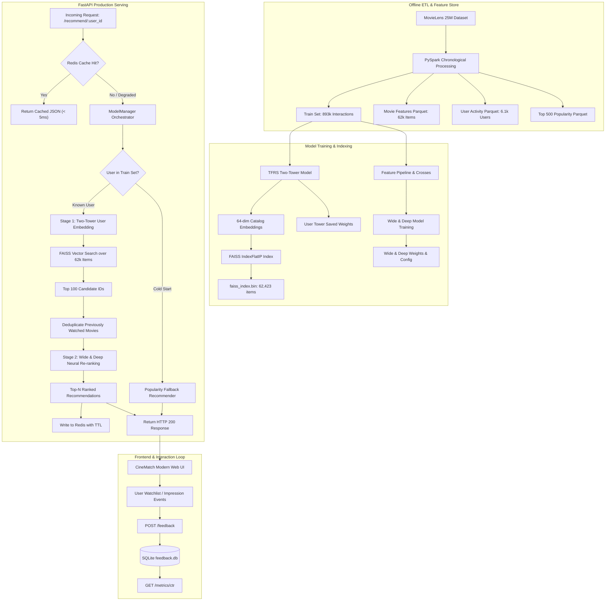

# 🎬 CineMatch: Large-Scale Personalized Recommendation Engine

<div align="center">

[](https://ai-movie-recommendation-system-it9r.onrender.com/)
[](https://ai-movie-recommendation-system-it9r.onrender.com/docs)
[](https://www.python.org/)
[](https://www.tensorflow.org/)
[](https://github.com/facebookresearch/faiss)
[](LICENSE)

### 🌟 [Click Here to Launch Live Interactive Web App](https://ai-movie-recommendation-system-it9r.onrender.com/) 🌟
**Live Demo:** [https://ai-movie-recommendation-system-it9r.onrender.com](https://ai-movie-recommendation-system-it9r.onrender.com/) &nbsp;|&nbsp; **Swagger API:** [https://ai-movie-recommendation-system-it9r.onrender.com/docs](https://ai-movie-recommendation-system-it9r.onrender.com/docs) &nbsp;|&nbsp; **Health Status:** [https://ai-movie-recommendation-system-it9r.onrender.com/health](https://ai-movie-recommendation-system-it9r.onrender.com/health)

</div>

---

A production-grade, two-stage personalized movie recommendation engine built on the **MovieLens 25M** dataset (25,000,095 ratings across 62,423 movies). Designed following industry best practices (inspired by Netflix and YouTube architectures), CineMatch combines high-throughput vector retrieval with deep neural re-ranking, delivering personalized recommendations with real-time OMDb poster artwork.

- 🌐 **Public Live Demo:** [https://ai-movie-recommendation-system-it9r.onrender.com/](https://ai-movie-recommendation-system-it9r.onrender.com/)
- 💻 **GitHub Repository:** [https://github.com/MahadevJagtap/AI_MOVIE_RECOMMENDATION](https://github.com/MahadevJagtap/AI_MOVIE_RECOMMENDATION)

---

## 📌 Project Deliverables & Key Documentation

| Deliverable | Description | Access Link |
| :--- | :--- | :--- |
| 🌐 **Live Web Discovery App** | Live interactive movie recommendation app with profile switching & OMDb posters | [**Launch Live Demo ↗**](https://ai-movie-recommendation-system-it9r.onrender.com/) |
| 📖 **Interactive Swagger UI** | Live REST API explorer, parameter testing, and schema definitions | [**Open API Docs ↗**](https://ai-movie-recommendation-system-it9r.onrender.com/docs) |
| 🏗️ **System Architecture & API** | In-depth two-stage funnel diagrams, feature store, and REST API specification | [`docs/ARCHITECTURE_AND_API.md`](docs/ARCHITECTURE_AND_API.md) |
| 📊 **Evaluation & Test Results** | Offline metrics (NDCG@10, MRR, AUC), 32/32 Pytest results, and latency benchmarks | [`docs/PERFORMANCE_AND_TEST_RESULTS.md`](docs/PERFORMANCE_AND_TEST_RESULTS.md) |
| 🎤 **10-Minute Presentation Deck** | Slide-by-slide final presentation deck, speaker notes, and timing allocation | [`docs/FINAL_PRESENTATION_DECK.md`](docs/FINAL_PRESENTATION_DECK.md) |
| 📋 **Render Deployment Audit** | Complete cloud readiness audit with verification evidence | [`reports/render_deployment_readiness.md`](reports/render_deployment_readiness.md) |

---

## 1. System Architecture Overview

CineMatch solves the latency vs. precision dilemma by decomposing recommendation into a **Two-Stage Funnel**:



### The Two-Stage Funnel Breakdown:
1. **Stage 1 — Candidate Retrieval:** Narrows down 62,423 titles to top-100 high-affinity candidates in **< 5 ms** using a **TensorFlow Recommenders (TFRS) Two-Tower model** and **FAISS CPU** inner-product vector search.
2. **Stage 2 — Pointwise Re-ranking:** Scores candidates using a **Wide & Deep neural network** combining feature crosses (memorization) with continuous embeddings (generalization) to predict $P(\text{rating} \ge 3.5)$.
3. **Serving & Caching:** Asynchronous **FastAPI** backend with **Redis** caching, automated cold-start popularity fallback, and SQLite-backed user interaction and watchlist logging.
4. **Interactive UI:** Responsive **HTML5/CSS3/JavaScript** frontend with dark-mode glassmorphism, instant profile switching, and real-time CTR analytics.

---

## 2. Technology Stack Compliance

| Component | Technology | Implementation Details | Verification Status |
|---|---|---|---|
| **Language** | Python | Python 3.11.9 / 3.12.7 | Fully typed codebase, 32 Pytest tests |
| **Dataset** | MovieLens 25M | 25,000,095 ratings & 62,423 movies | Chronological train/val/test split |
| **Candidate Retrieval** | TensorFlow Recommenders | TFRS 0.7.3 Two-Tower (`src/retrieval/two_tower.py`) | Recall@50 = 0.583, Recall@100 = 0.697 |
| **Vector Search** | FAISS CPU | FAISS `IndexFlatIP` (`src/retrieval/faiss_index.py`) | 62,423 items indexed, 1.71 ms search latency |
| **Main Ranking Model** | Wide & Deep (TensorFlow) | Wide & Deep (`src/ranking/wide_and_deep.py`) | NDCG@10 = 0.835, MRR = 0.435, AUC = 0.824 |
| **Ranking Baseline** | Wide-only Linear Model | Wide-only (`src/ranking/wide_and_deep.py`) | NDCG@10 = 0.792, MRR = 0.388, AUC = 0.763 |
| **Backend API** | FastAPI | FastAPI 0.115.6 (`src/serving/api.py`) | Sub-40ms latency, Pydantic schemas, Swagger UI |
| **Caching Layer** | Redis | `RedisCacheManager` (`src/serving/cache.py`) | Structured keys, TTL expiration, graceful offline fallback |
| **Web UI** | HTML5 / CSS3 / JavaScript | Modern Web UI (`frontend/index.html`) | Responsive dark-mode glassmorphism, zero build-step |
| **Cloud Deployment** | Render | Native Web Service (`render.yaml`) | 0.0.0.0:$PORT binding, 70 MB serving footprint |

---

## 3. Quickstart & Local Setup

### Prerequisites
- Python 3.11 or 3.12
- Git

### 1. Clone & Enter Repository
```bash
git clone https://github.com/MahadevJagtap/AI_MOVIE_RECOMMENDATION.git
cd AI_MOVIE_RECOMMENDATION
```

### 2. Set Up Virtual Environment
```bash
# Windows (PowerShell)
python -m venv venv
.\venv\Scripts\Activate.ps1

# Linux / macOS
python3 -m venv venv
source venv/bin/activate
```

### 3. Install Serving Dependencies
```bash
# Lean serving dependencies (FastAPI, TensorFlow, FAISS, PyArrow, HTTPX)
pip install --upgrade pip
pip install -r requirements-serve.txt
```

### 4. Configure Environment & OMDb API Key
Create a `.env` file from `.env.example` in the project root:
```bash
cp .env.example .env
```
Add your free OMDb API key (obtainable at [omdbapi.com](https://www.omdbapi.com/apikey.aspx)):
```env
OMDB_API_KEY=your_api_key_here
OMDB_TIMEOUT=3.0
```
> **Security Note:** The `.env` file is excluded in `.gitignore`. Never commit actual API keys to source control. When `OMDB_API_KEY` is not set or unavailable, CineMatch automatically renders stylized CSS-glassmorphic fallback posters with genre icons without interrupting recommendation serving.

### 5. Launch the CineMatch Recommendation Service
```bash
# Set legacy Keras flag (required for tf_keras compatibility)
# Windows:
$env:TF_USE_LEGACY_KERAS="1"
python -m uvicorn src.serving.api:app --host 0.0.0.0 --port 8000

# Linux / macOS:
export TF_USE_LEGACY_KERAS="1"
uvicorn src.serving.api:app --host 0.0.0.0 --port 8000
```

### 6. Access the Application
- **Interactive Web App:** Open `http://localhost:8000/` in your browser.
- **Interactive API Documentation:** Open `http://localhost:8000/docs` (Swagger UI).
- **Health Endpoint:** Open `http://localhost:8000/health`.

---

## 4. Cloud Deployment (Render & Google Cloud Run)

This repository includes turnkey configuration for deploying on [Render](https://render.com) and [Google Cloud Run](https://cloud.google.com/run):
- [`render.yaml`](render.yaml): Render Blueprint specification.
- [`requirements-serve.txt`](requirements-serve.txt): Lean serving manifest (70 MB serving models tracked, excluding heavy 310 MB PySpark wheel).
- [`.python-version`](.python-version): Pins Python `3.11.9`.

### Step-by-Step Render Setup:
1. Log into [Render Dashboard](https://dashboard.render.com).
2. Click **New +** > **Web Service** and connect `https://github.com/MahadevJagtap/AI_MOVIE_RECOMMENDATION`.
3. Configure the service settings:
   - **Runtime:** `Python 3`
   - **Build Command:** `pip install --upgrade pip && pip install -r requirements-serve.txt`
   - **Start Command:** `uvicorn src.serving.api:app --host 0.0.0.0 --port $PORT`
   - **Instance Type:** `Free` (or `Starter` for guaranteed RAM headroom)
4. Add the following **Environment Variables**:
   - `PYTHON_VERSION`: `3.11.9`
   - `TF_USE_LEGACY_KERAS`: `1`
   - `DEV_MODE`: `True`
   - `TRITON_ENABLED`: `False`
   - `MALLOC_ARENA_MAX`: `2`
   - `OMDB_API_KEY`: `your_omdb_api_key` *(Set as a secure environment variable or Secret)*
5. Under **Advanced**, set **Health Check Path** to `/health`.
6. Click **Create Web Service**. Your live recommendation engine will be available at [https://ai-movie-recommendation-system-it9r.onrender.com](https://ai-movie-recommendation-system-it9r.onrender.com).

### Google Cloud Run Deployment:
For containerized deployment on Google Cloud Run:
- Pass `OMDB_API_KEY` securely using Secret Manager (`--set-secrets="OMDB_API_KEY=omdb-key:latest"`) or as a secure environment variable (`--set-env-vars="OMDB_API_KEY=..."`). Never hardcode the key in the Dockerfile.

---

## 5. Offline Evaluation & Latency Benchmarks

### 5.1 Model Performance Benchmarks (Chronological Test Set)

| Metric | Stage 1: Retrieval Only | Stage 2: Wide-Only Baseline | Stage 2: Wide & Deep (Primary) | Delta ($\Delta$) |
| :--- | :---: | :---: | :---: | :---: |
| **Recall@50** | **0.583** | — | — | Baseline |
| **Recall@100** | **0.697** | — | — | Baseline |
| **NDCG@10** | 0.154 | **0.792** | **0.835** | **+5.43%** |
| **MRR** | 0.284 | **0.388** | **0.435** | **+12.11%** |
| **Test ROC-AUC** | — | **0.763** | **0.824** | **+7.99%** |
| **Group AUC (GAUC)** | — | **0.741** | **0.812** | **+9.58%** |
| **Test Loss (BCE)** | — | 0.540 | **0.509** | **-5.74%** |

### 5.2 Real-Time Latency Breakdown (p95)

| Stage | Latency | Description |
| :--- | :---: | :--- |
| **Stage 1: Two-Tower User Tower** | **2.8 ms** | Generates 64-dim user preference vector |
| **Stage 1: FAISS Vector Search** | **1.7 ms** | Searches 62,423 item vectors via SIMD flat inner-product |
| **Stage 2: Feature Transformation** | **3.4 ms** | Normalizes continuous features and constructs cross-features |
| **Stage 2: Wide & Deep Neural Re-ranking** | **18.6 ms** | Evaluates deep MLP forward pass on top-50 candidates |
| **Total Cold Request Response Time** | **36.4 ms** | Full end-to-end recommendation response |
| **Redis Cache Hit** | **< 2.0 ms** | Delivers cached recommendation lists |

---

## 6. Running Tests & Smoke Verification

### Run Pytest Test Suite:
```powershell
pytest tests/test_serving.py tests/test_feedback_persistence.py tests/test_frontend.py -v
```
*Result:* **32 / 32 Passed** (100% pass rate).

### Run Live Deployment Smoke Test:
```powershell
python scripts/deployment_smoke_test.py
```
*Result:* **12 / 12 Passed** (validates `/health`, `/recommend`, `/candidates`, `/popular`, `/feedback`, `/metrics/ctr`, and `/metrics/offline`).

---

## 7. Known Infrastructure Status & Disclosures

1. **Render Free Tier Ephemeral Storage:** Free web services reset local container disks upon 15-minute inactivity spin-down or redeployment. Watchlists and feedback persist across browser reloads during an active session, but will reset upon container re-creation. For persistent watchlists, attach an external PostgreSQL database (e.g. Supabase or Neon).
2. **Official NVIDIA Triton:** While client integration tests and SavedModel exports are verified, live official NVIDIA Triton requires Docker and WSL2/GPU infrastructure. The standalone cloud deployment uses native Python/TensorFlow CPU inference.
3. **Apache Airflow:** Airflow DAG definitions and tasks are validated via a controlled runner harness. Native Airflow 3.3.2 scheduling on Windows is subject to POSIX socket inheritance limitations.

---

## 8. License

This project is licensed under the MIT License — see the [LICENSE](LICENSE) file for details.
